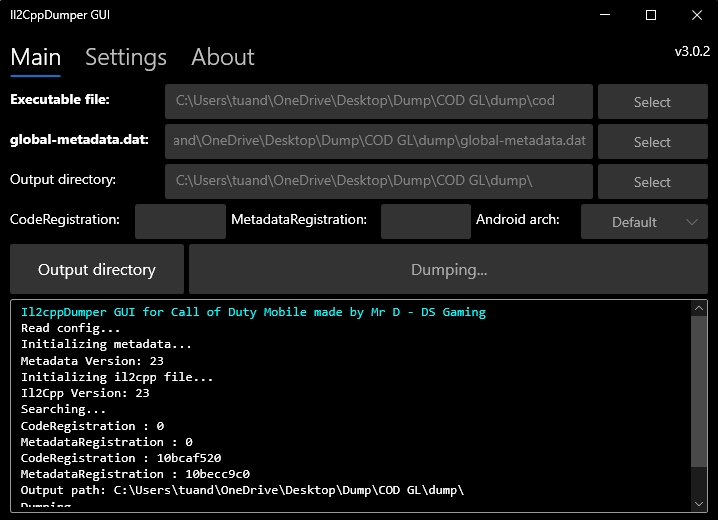

# Il2CppDumper for Call of Duty Mobile

This is a customized version of **Unity Il2CppDumper GUI**, developed based on the original source code by **Perfare**.

This version has been optimized and modified to work with **Call of Duty Mobile**.

- ✅ Runs on **Windows**
- ✅ Supports both **Android** and **iOS**
- ✅ User-friendly and intuitive GUI
- ✅ Supports generating **structs**, **dummy DLLs**, and exporting scripts for IDA/Ghidra/Hopper

---

## ⚠️ Important Notice – Encrypted Metadata

> [!IMPORTANT]
> **Newer versions of Call of Duty Mobile use encrypted Metadata.**
>
> In addition to the `Executable file` and `global-metadata.dat`, you need to prepare an additional file named **`anort`**.
>
> This file is used to extract the necessary data required to decrypt `global-metadata.dat`.

### 📌 Where to Place the `anort` File

You only need to place the `anort` file in **ONE OF THE FOLLOWING LOCATIONS**:

1. In the same directory as `global-metadata.dat`.
2. In the same directory as `Il2CppDumper GUI.exe`.

> [!WARNING]
> **What happens if the `anort` file is missing?**
>
> The tool will automatically use the built-in **fallback data** for the decryption process.
>
> However, the fallback data may not be compatible with newer CODM versions if the game has been updated or modified. This may cause errors during metadata decryption or data extraction.
>
> **Recommendation:** Always prepare the `anort` file corresponding to your game version to minimize errors and ensure a more stable dumping process.

---

## 🚀 How to Use

**1. Prepare the required files:**

- `libil2cpp.so` (Android) or the game's main Executable file (iOS).
- `global-metadata.dat`.

**2.** Run `Il2CppDumper GUI.exe`.

**3.** Select the corresponding file paths:

- **Executable file** → Select `libil2cpp.so` or the game's main Executable file.
- **global-metadata.dat** → Select the game's metadata file.
- **Output directory** → Select the folder where the results will be saved.

**4.** Click **Start** → The tool will automatically:

- Dump data.
- Generate structs.
- Generate dummy DLLs.
- Copy analysis scripts into the output directory.

**5.** Open `dump.cs` or the dummy DLL using **dnSpy/ILSpy** for further analysis.

---

## 🙏 Credits

- **[Perfare](https://github.com/Perfare)** – Original creator of Il2CppDumper.
- **[AndnixSH](https://github.com/AndnixSH)** – Creator of the previous GUI version.
- **[tien0246](https://github.com/tien0246)** – Il2CppDumper improvements (CODM-specific version).
- **Mr D - DS Gaming** – Developer of this customized GUI version for CODM (Android/iOS).